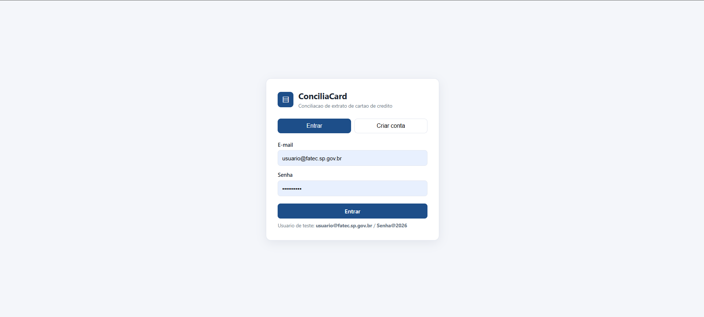
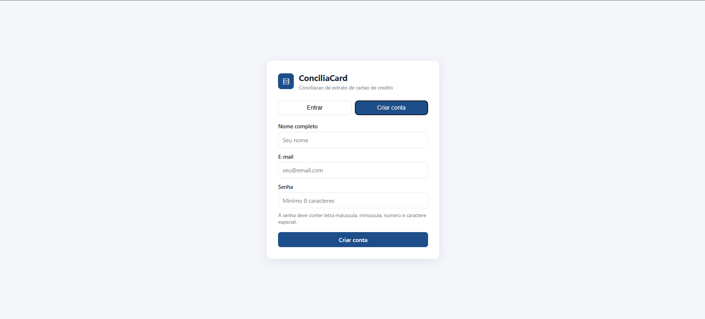
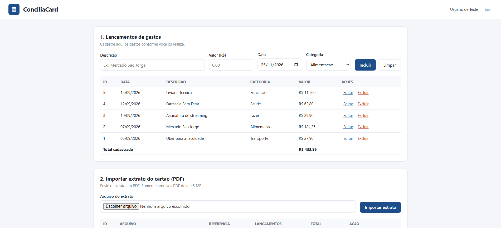
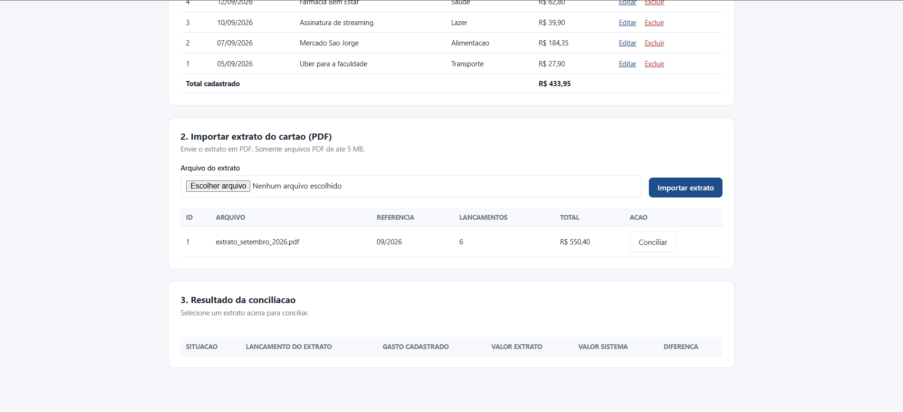
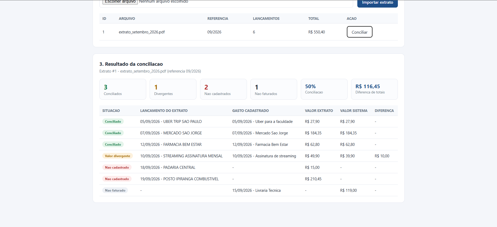

# ConciliaCard — Conciliação de Extrato de Cartão de Crédito

Projeto acadêmico da disciplina **Laboratório de Engenharia de Software** — FATEC Ipiranga / Centro Paula Souza
Prof. Veríssimo · Semestre 2026/2 · **MVP v1.0-mvp**

> **Aviso:** os extratos utilizados são **fictícios**, gerados pelo script `samples/gerar_extrato.py`.
> O sistema não se conecta a nenhuma instituição financeira e não processa dados reais de cartão.

## Equipe

Lucas dos Santos Rodrigues — RA 2040482313003 — turno: Noturno. Participação: 100%.

GitHub: https://github.com/lucas-fatec/conciliacard

Vídeo: [inserir link após gravação]. Figma: não disponível; protótipo HTML em `prototipo/`.

## O que o sistema faz

O usuário registra seus gastos ao longo do mês. Quando a fatura fecha, ele importa o extrato do
cartão em PDF. O sistema compara os dois lados e classifica cada linha:

| Situação | Significado |
|---|---|
| **Conciliado** | Diferença de valor de até R$ 0,01 e diferença de datas de até 3 dias |
| **Valor divergente** | Descrições semelhantes, valores diferentes |
| **Não cadastrado** | Está no extrato, mas o usuário não registrou |
| **Não faturado** | O usuário registrou, mas ainda não foi cobrado |

## Casos de uso do MVP

| Código | Caso de Uso | Endpoints |
|---|---|---|
| UC01 | Autenticação de Usuário | `POST /api/auth/cadastro`, `POST /api/auth/login` |
| UC02 | Manter Lançamentos de Gastos | `GET/POST/PUT/DELETE /api/gastos` |
| UC03 | Importar Extrato do Cartão (PDF) | `POST /api/extratos`, `GET /api/extratos` |
| UC04 | Conciliar Extrato | `GET /api/conciliacao/:extratoId` |

## Arquitetura

```
Navegador  ──►  frontend-conciliacard (Nginx :8080)
                        │  proxy /api/
                        ▼
                backend-conciliacard (Node.js 18 + Express :3000)
                        │  SQL
                        ▼
                 db-conciliacard (MySQL 8.0 :3306)
```

O Nginx faz proxy de `/api/` para a API, o que elimina problemas de CORS e evita endereço
fixo no JavaScript.

## Estrutura do repositório

```
.
├── docker-compose.yml          # orquestração dos 3 serviços
├── README.md
├── bd/
│   ├── Dockerfile              # imagem do MySQL
│   └── init.sql                # tabelas + massa de dados de teste
├── backend/
│   ├── Dockerfile              # imagem da API
│   ├── package.json
│   ├── src/
│   │   ├── index.js            # rotas da API
│   │   ├── auth.js             # UC01 — autenticação e política de senha
│   │   ├── db.js               # pool MySQL + espera pelo banco
│   │   ├── pdfTexto.js         # extração de texto do PDF
│   │   ├── parserExtrato.js    # UC03 — texto → lançamentos (módulo puro)
│   │   └── conciliador.js      # UC04 — regras RN-01 a RN-05 (módulo puro)
│   └── tests/                  # 24 testes automatizados (Jest)
├── frontend/
│   ├── Dockerfile              # imagem do Nginx
│   ├── nginx.conf
│   ├── index.html              # tela de login/cadastro
│   ├── app.html                # painel
│   ├── script.js
│   └── style.css
├── samples/
│   ├── gerar_extrato.py        # gera os extratos fictícios
│   ├── extrato_setembro_2026.pdf
│   └── extrato_invalido_sem_lancamentos.pdf
├── prototipo/
│   └── Prototipo_ConciliaCard.html
```

## Como executar

Pré-requisitos: **Docker Desktop** em execução; porta 8080 livre.

```bash
docker compose up -d       # sobe os 3 contêineres
docker compose ps          # confirma status Up / Healthy
```

Acesse **http://localhost:8080** e entre com:

| Campo | Valor |
|---|---|
| E-mail | `usuario@fatec.sp.gov.br` |
| Senha | `Senha@2026` |

Conta inativa para demonstrar bloqueio: `inativo@fatec.sp.gov.br`, mesma senha. Não existem papéis administrativos distintos.

Para configuração local opcional, copie `.env.example` para `.env`. Os valores padrão são exclusivamente fictícios; substitua-os antes de qualquer publicação.

Depois importe `samples/extrato_setembro_2026.pdf` e clique em **Conciliar**.

Para parar e limpar tudo (inclusive o banco, para recomeçar do zero):

```bash
docker compose down -v
```

### Executar os testes automatizados

```bash
cd backend
npm ci
npm test
```

A suíte contém 4 arquivos de teste e 24 testes. A execução completa permanece pendente.

### Regerar os extratos fictícios

```bash
cd samples
pip install reportlab
python3 gerar_extrato.py
```

## Variáveis de ambiente do backend

| Variável | Padrão | Descrição |
|---|---|---|
| `DB_HOST` | `db-conciliacard` | host do MySQL (use `localhost` fora do Docker) |
| `DB_USER` / `DB_PASSWORD` | `root` / `demo-local-db` | credenciais do banco |
| `DB_NAME` | `conciliacard` | nome do banco |
| `JWT_SECRET` | `demo-local-only-change-before-publication` | chave de assinatura do token |
| `PORT` | `3000` | porta da API |

## Formato de extrato aceito (UC03)

Cada lançamento deve estar em uma linha, no padrão:

```
05/09/2026   UBER TRIP SAO PAULO          R$ 27,90
```

Data `dd/mm/aaaa`, descrição e valor em formato brasileiro. O prefixo `R$` é opcional.
Linhas com valor negativo (pagamentos e créditos) são ignoradas, assim como qualquer
linha que não siga o padrão.


## Telas do sistema

### Login



### Cadastro



### Gastos



### Importacao



### Conciliacao




## Organização retrospectiva das Sprints

Concentrei a implementação na primeira Sprint. Para organizar a evolução funcional do projeto, distribuí retrospectivamente os casos de uso em quatro etapas, conforme suas dependências. A distribuição abaixo representa uma organização do escopo, não um registro de entregas nas datas originais.

- **Sprint 01 — UC01:** Autenticação e cadastro de conta. Login, cadastro, JWT, hash de senha e bloqueio de conta inativa. Evidência: telas de login e cadastro.
- **Sprint 02 — UC02:** Gerenciamento de gastos. Inclusão, consulta, edição e exclusão de gastos; categorias e total cadastrado. Evidência: painel de gastos.
- **Sprint 03 — UC03:** Importação de extratos. Upload de PDF, interpretação de lançamentos e persistência dos itens. Evidência: extrato de setembro de 2026 listado na interface.
- **Sprint 04 — UC04:** Conciliação de gastos. Comparação de registros, classificação de divergências e indicadores. Evidência: resultado com 50% de conciliação.
- **MVP:** Consolidação e disponibilização. Revisão do Docker, README, carga inicial e segurança; documentação e testes parciais.
